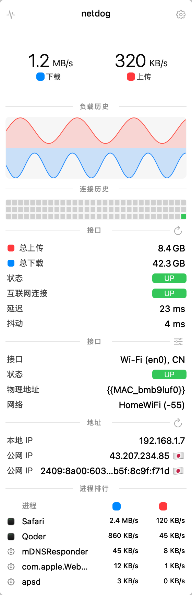
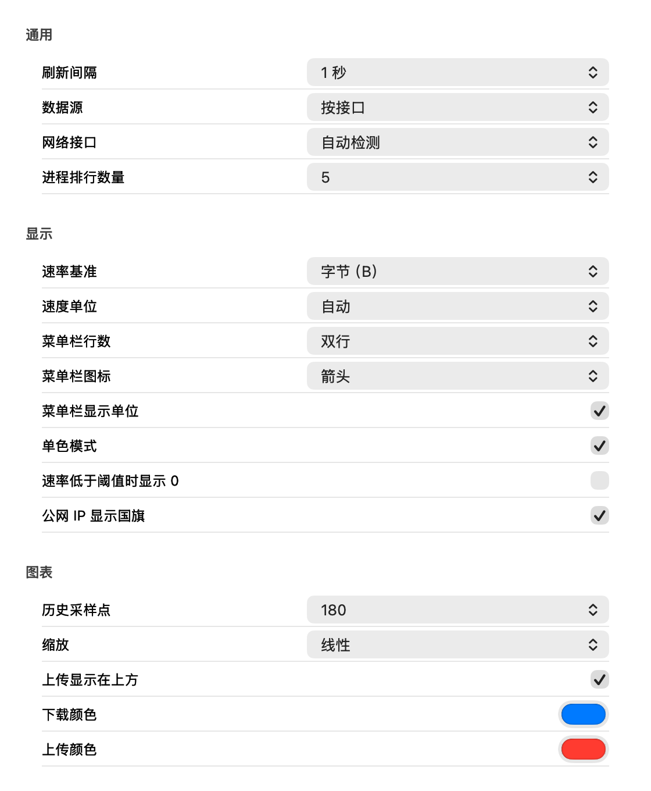

# NetDog

A minimal macOS menu bar network monitor, extracted from [Stats](https://github.com/exelban/stats) and trimmed down to the network module only.

macOS 13+ · Swift · MIT License

## Features

- Live download/upload speed in the menu bar (two-row or one-row, dots/arrows/no icon, units toggle, monochrome, idle threshold)
- Stats-style popup: usage history chart, connectivity history grid, traffic totals, interface & Wi-Fi details, addresses, top processes — every section can be enabled/disabled
- Bandwidth from interface counters (`sysctl NET_RT_IFLIST2`) or per-process totals (`nettop`)
- Connectivity probe: ICMP first, HTTP fallback; latency and jitter
- Public IP lookup (`ip.mac-stats.com`) with optional auto-refresh
- Usage totals persisted across launches, with never/at-start/daily/weekly/monthly reset
- Full network settings ported from Stats and applied live
- Launch at login

## Screenshots

<table>
  <tr>
    <td align="center"></td>
    <td align="center"></td>
  </tr>
  <tr>
    <td align="center">Popup</td>
    <td align="center">Settings</td>
  </tr>
</table>

## Install

1. Download `NetDog-0.2.1.zip` from [Releases](https://github.com/hellolib/netdog/releases).
2. Unzip and drag `NetDog.app` into `/Applications`.
3. The app is ad-hoc signed. If macOS blocks the first launch, right-click the app → **Open**.

Requires macOS 13 or later.

## Build from source

Xcode Command Line Tools are enough (no SwiftPM needed):

```bash
make app     # build build/NetDog.app (swiftc + ad-hoc signing)
make run     # build and launch
make check   # compare sampling against netstat
make dist    # produce build/NetDog-<version>.zip
make install # copy to /Applications
```

## Configuration

Click the menu bar item → right-click → **Settings…**. Options are grouped as:

- **General** — refresh interval, bandwidth source (interface/process), interface selection, process count
- **Display** — byte/bit base, speed unit, menu bar rows/icon/units/monochrome, idle threshold, country flags
- **Chart** — history length, scale (linear/square/cube/log/fixed), upload-on-top, download/upload colors
- **Popup sections** — show or hide each of the six popup sections
- **Usage** — reset policy
- **Public IP** — enable, auto-refresh interval
- **Connectivity** — auto/ICMP/HTTP, hosts, probe interval
- **Launch** — launch at login

## Permissions

- **Location** — required to read the Wi-Fi SSID/BSSID (macOS 10.15+). The popup offers a shortcut button when access has not been granted.
- No sandbox, no network extension, no privileged helper.

## Data sources

- Interface bandwidth: `sysctl(NET_RT_IFLIST2)` byte counters
- Process bandwidth: `nettop` (all interfaces)
- Connectivity: ICMP echo by default (`223.5.5.5`), automatic HTTP fallback (`captive.apple.com`)
- Public IP: `ip.mac-stats.com`

## Credits

Based on [Stats](https://github.com/exelban/stats) by Serhiy Mytrovtsiy (MIT). The app icon is derived from the Stats waveform motif.

## License

[MIT](LICENSE)

---

## 中文说明

NetDog 是一个极简的 macOS 菜单栏网络监控器，从 [Stats](https://github.com/exelban/stats) 中裁剪而来，只保留网络模块。

### 功能

- 菜单栏实时上下行速率（双行/单行、圆点/箭头/无图标、单位开关、单色、空闲阈值）
- Stats 风格弹窗：负载历史曲线、连接历史点阵、流量统计、接口与 Wi-Fi 详情、地址、进程排行，每个栏目可独立开关
- 带宽数据源：接口计数器（`NET_RT_IFLIST2`）或按进程统计（`nettop`）
- 连通性检测：ICMP 优先、HTTP 兜底，显示延迟与抖动
- 公网 IP 查询（`ip.mac-stats.com`），可配置自动刷新
- 累计流量持久化，支持从不/启动时/每天/每周/每月重置
- 完整移植 Stats 网络设置，全部改动即时生效
- 支持登录时自动启动

### 安装

1. 从 [Releases](https://github.com/hellolib/netdog/releases) 下载 `NetDog-0.2.1.zip`
2. 解压后把 `NetDog.app` 拖进 `/Applications`
3. 当前为 ad-hoc 签名；首次打开若被系统拦截，请右键 → 打开

### 从源码构建

只需 Xcode Command Line Tools：

```bash
make app     # 生成 build/NetDog.app（swiftc 直编 + ad-hoc 签名）
make run     # 构建并启动
make check   # 与 netstat 对照采样
make dist    # 生成 build/NetDog-<version>.zip
make install # 安装到 /Applications
```

### 权限

- **定位**：读取 Wi-Fi 名称（SSID/BSSID）需要定位权限；未授权时弹窗内会显示授权按钮
- 不使用沙盒、网络扩展或特权辅助进程

### 致谢与许可

基于 Serhiy Mytrovtsiy 的 [Stats](https://github.com/exelban/stats)（MIT）移植；应用图标取自 Stats 波形意象。本项目使用 [MIT 许可证](LICENSE)。
