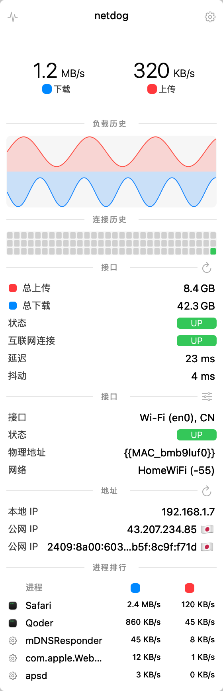
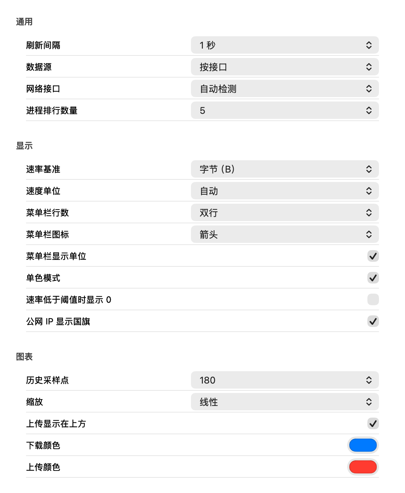

<p align="center">
  
</p>

<h1 align="center">NetDog</h1>

<p align="center">极简的 macOS 菜单栏网络监控器，从 <a href="https://github.com/exelban/stats">Stats</a> 裁剪而来，只保留网络模块。</p>

<p align="center">macOS 13+ · Swift · MIT 许可证</p>

<p align="center">
  <a href="README.md">English</a> ·
  <a href="README.zh-CN.md">简体中文</a>
</p>

## 功能

- 菜单栏实时上下行速率（双行/单行、圆点/箭头/无图标、单位开关、单色、空闲阈值）
- Stats 风格弹窗：负载历史曲线、连接历史点阵、流量统计、接口与 Wi-Fi 详情、地址、进程排行，每个栏目可独立开关
- 带宽数据源：接口计数器（`NET_RT_IFLIST2`）或按进程统计（`nettop`）
- 连通性检测：ICMP 优先、HTTP 兜底，显示延迟与抖动
- 公网 IP 查询（`ip.mac-stats.com`），可配置自动刷新
- 累计流量持久化，支持从不/启动时/每天/每周/每月重置
- 完整移植 Stats 网络设置，所有改动即时生效
- 支持登录时自动启动

## 截图

<table>
  <tr>
    <td align="center"></td>
    <td align="center"></td>
  </tr>
  <tr>
    <td align="center">弹窗</td>
    <td align="center">设置</td>
  </tr>
</table>

## 安装

1. 从 [Releases](https://github.com/hellolib/netdog/releases) 下载 `NetDog-0.2.1.zip`
2. 解压后把 `NetDog.app` 拖进 `/Applications`
3. 当前为 ad-hoc 签名；首次打开若被系统拦截，请右键 → 打开

需要 macOS 13 或更高版本。

## 从源码构建

只需 Xcode Command Line Tools（不依赖 SwiftPM）：

```bash
make app     # 生成 build/NetDog.app（swiftc 直编 + ad-hoc 签名）
make run     # 构建并启动
make check   # 与 netstat 对照采样
make dist    # 生成 build/NetDog-<version>.zip
make install # 安装到 /Applications
```

## 配置

点击菜单栏图标 → 右键 → **设置…**，配置按组划分：

- **通用** — 刷新间隔、数据源（接口/进程）、网络接口选择、进程排行数量
- **显示** — 字节/比特、速度单位、菜单栏行数/图标/单位/单色、空闲阈值、国旗
- **图表** — 历史采样点、缩放（线性/平方/立方/对数/固定上限）、上传在上、上下行颜色
- **弹窗栏目** — 六个弹窗区块的显示开关
- **用量统计** — 重置策略
- **公网 IP** — 开关、自动刷新间隔
- **连通性** — 自动/ICMP/HTTP、主机地址、检测间隔
- **启动** — 登录时自动启动

## 权限

- **定位** — 读取 Wi-Fi 名称（SSID/BSSID）需要定位权限（macOS 10.15+）；未授权时弹窗内会显示授权按钮
- 不使用沙盒、网络扩展或特权辅助进程

## 数据来源

- 接口带宽：`sysctl(NET_RT_IFLIST2)` 字节计数器
- 进程带宽：`nettop`（全接口）
- 连通性：默认 ICMP（`223.5.5.5`），失败自动回退 HTTP（`captive.apple.com`）
- 公网 IP：`ip.mac-stats.com`

## 致谢

基于 Serhiy Mytrovtsiy 的 [Stats](https://github.com/exelban/stats)（MIT）移植；应用图标取自 Stats 波形意象。

## 许可证

[MIT](LICENSE)
